# SWAY_WIN_IR_TOOLS应急响应工具

SWAY_WIN_IR_TOOLS是一款综合全面的应急响应工具，且支持以MCP方式启动，实现ai自动化应急响应分析排查，用于在应急响应现场快速排查 Windows 主机，该工具是本人容纳自身应急响应的经验，且参考网上各位大佬的应急思路集成的一个应急响应工具，工程师可以在图形界面中逐项查看浏览器、进程、持久化、日志、文件和网络等痕迹，定位可疑程序、账户、启动项和外联行为。

此外工具同时提供 MCP 接口。接入后，AI 可以自动化按排查需要自动调用各项能力收集证据、完成分析，并给出处置方法，由现场工程师执行，且这个MCP服务的优势在于，工具完全是只读的，从而排除模型误报调用增删改的风险。

## 支持的操作系统

仅支持 64 位系统：

- Windows 10、Windows 11
- Windows Server 2012 R2 及以上的服务器系统

32 位 Windows 和 ARM64 Windows 不在支持范围内。部分排查需要管理员权限才能读到安全日志、进程内存和其他受保护的数据。

## 排查功能

### 浏览器排查

视图为插件时，可以查看本机 Chrome 与 Edge 的插件记录，核对插件来源、权限、安装时间，用于发现恶意插件和从浏览器落地的样本，且支持右键点击隔离并删除，若点击则会把这个插件从游览器中删除掉，并把这个插件相关的文件保存在隔离证据目录./evidence/browser_extensions下，便于后续应急响应人员取证分析处理，也可直接直接在取证目录删除这个恶意插件相关文件。

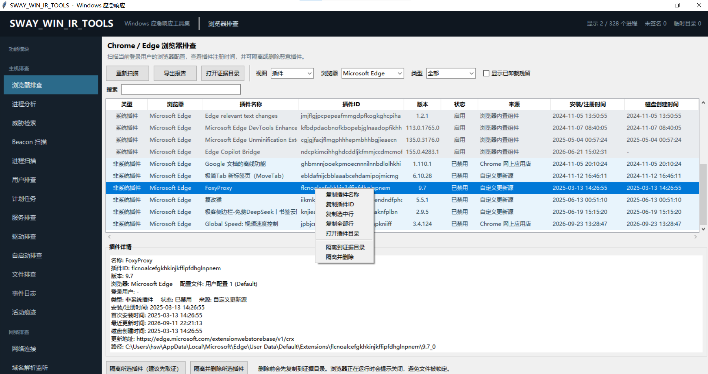

视图为下载记录时，会通过自动扫描并解析系统内已安装的 Chrome 和 Edge 浏览器的数据库，快速提取并展示用户在游览器的文件下载记录（包括文件名、保存路径、来源 URL 和下载时间等详细信息），用于分析溯源攻击者的恶意载荷投递。

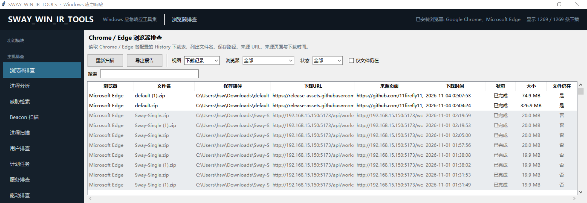

### 进程分析

会列出所有进程名称、当前进程PID、父进程的ID号、用户、进程启动时间、是否签名、公司、位置、进程运行的文件路径，单点一个进程可查看进程详情会列出更多的信息，右键支持计算这个恶意进程所属文件的SHA256和MD5的哈希值，也可以右键查看这个进程加载的所有dll情况，也支持右键查看进程树信息，也支持右键进行内存取证来进行mini Dump或Full Dump，此外还支持微步、VT的沙箱查询，便于判断该进程所属文件是否是恶意文件。

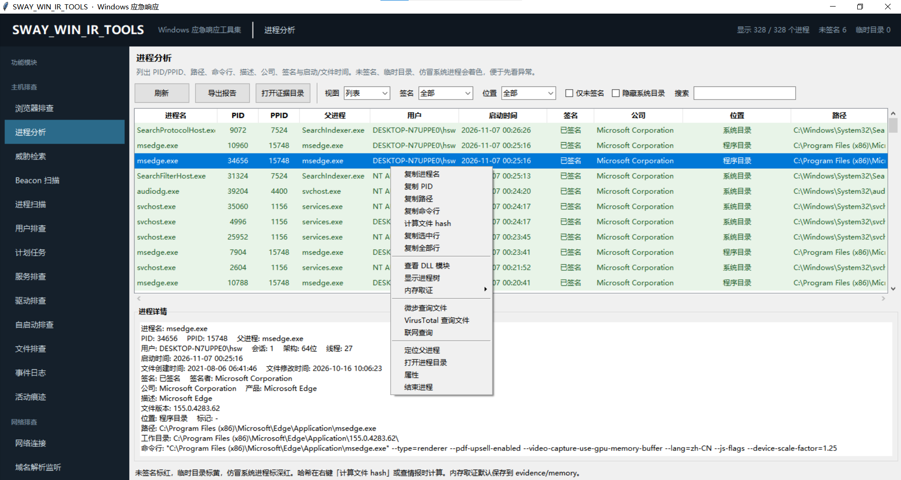	

当选择某个进程右键点击查看DLL模块，会显示dll的加载情况，需要重点关注那些签名异常和未签名的dll，针对白进程+黑dll场景这个地方是最容易取证的，黑dll往往是未签名或者签名异常的。并且也支持加载的dll进行微步、VT和联网查询。

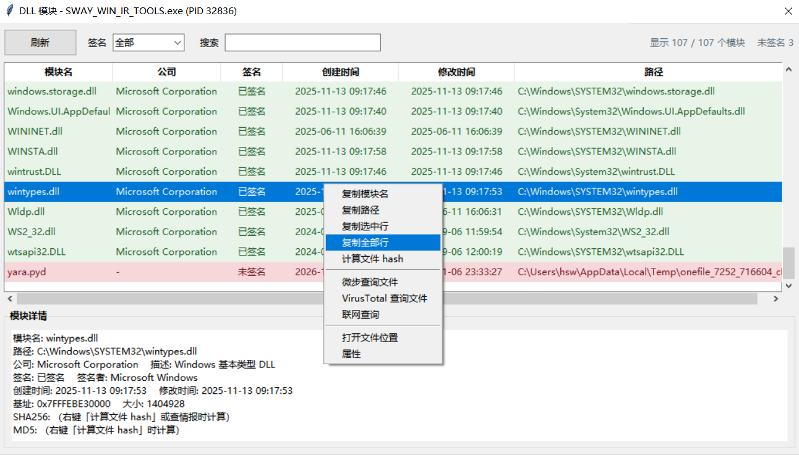	

### 威胁检索

按给定的进程名、路径、命令行、模块、文件哈希或内存特征在本机进程中检索。哈希支持 MD5、SHA1 和 SHA256。用于在已知 IOC 的情况下确认主机是否已经被植入对应程序。比如下图可以搜索www.baidu.com，来看哪些进程内存存在这个信息，在真实攻防场景，如果存在恶意外联的ip地址，那么可以输入外联的恶意ip进行搜索，从而定位恶意进程。内存限制设置256MB需要额外做说明，如果一个进程是1GB，那么相当于只会扫描该进程256MB的内存，如果没搜索到就跳过该进程。

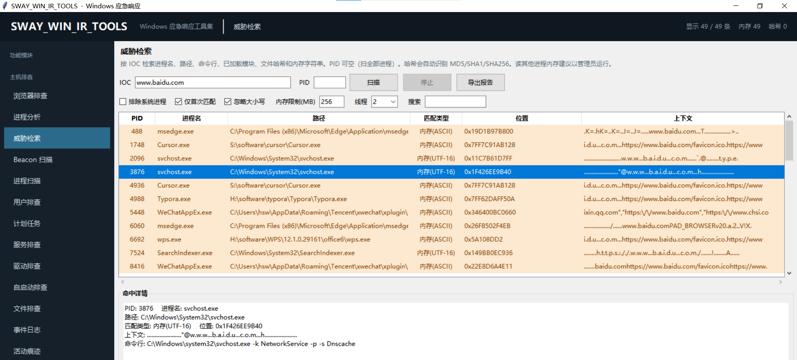	

### Beacon 扫描

扫描进程堆内存，查找 Cobalt Strike Beacon 的配置。命中后可查看解析出的通信配置，用于确认主机上是否存在 Beacon 植入。如下图可以点击扫描，那么会对所有进程进行扫描，若存在默认cs配置的木马进程，则会被扫描出来。

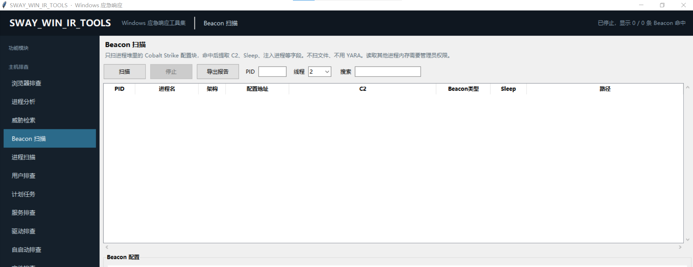	

### 进程扫描

使用 YARA 规则扫描全部进程的内存，返回命中的规则、威胁名称、内存地址和严重性。用于发现只存在于内存中、磁盘上没有完整文件的恶意代码，从而定位恶意进程。

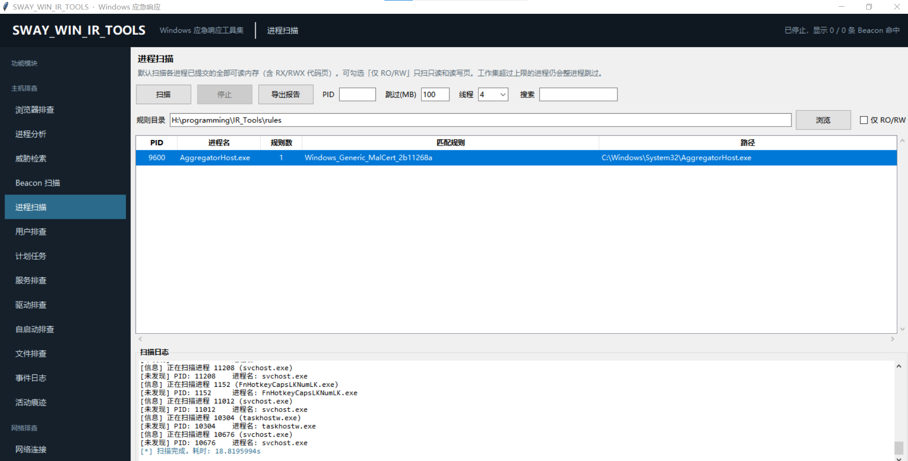	

### 用户排查

列出本机账户的启用、锁定、管理员和当前登录状态，并标出隐藏账户和 RID 劫持迹象。用于发现攻击者新建或藏起来的账户。

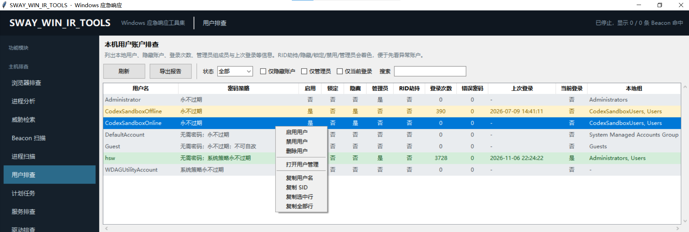	

### 计划任务

该模块相比网上其他的应急响应工具，会显示计划任务的创建时间和是否签名，主要原理是利用创建计划任务会在C:\Windows\System32\Tasks\目录下生成文件，那么利用这个文件的创建时间来作为这个计划任务的创建时间，而签名是根据计划任务指定运行的载荷文件决定的，如果载荷文件没签名，则无签名，若载荷文件有签名，则认为有签名，此外这个计划任务排查可以查看计划任务的程序、参数、运行身份、触发器、状态和签名，且可以对计划任务实际运行的程序做 YARA 磁盘扫描。用于发现通过计划任务保持驻留或定时执行的程序。

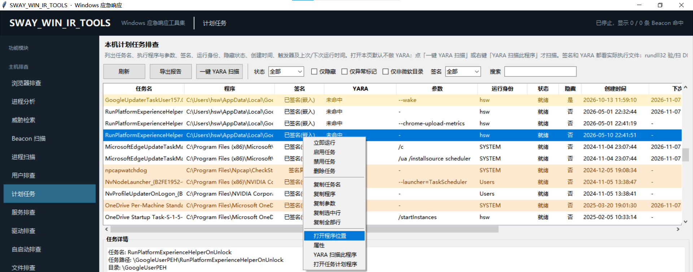	

### 服务排查

列出服务的创建时间、启动类型、状态、程序路径和签名，并对服务程序或参数中的载荷做 YARA 扫描。用于发现伪装成服务的恶意程序。

同样的道理自启动服务是否前面，是看自启动服务指定的文件路径，看这个所属文件是否有签名，这样便于排查无签名的服务项，这种相对来说会更可疑。

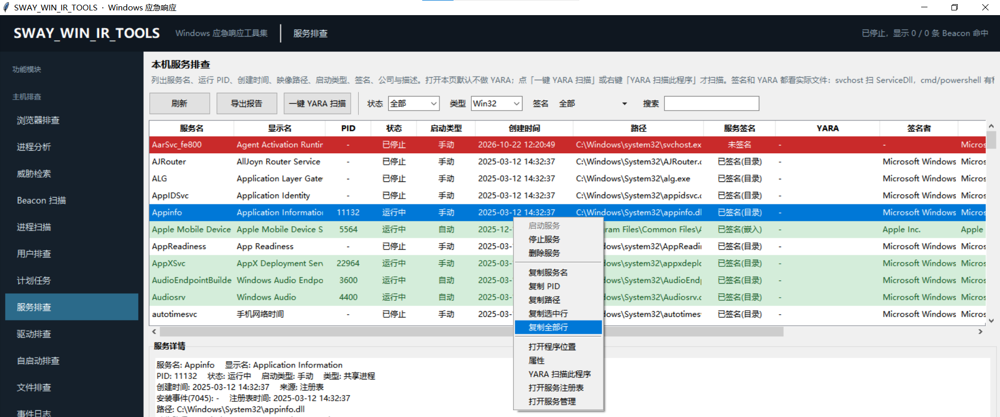	

### 驱动排查

列出内核驱动、文件系统驱动和已加载模块，核对签名、路径和加载状态，并对驱动文件做 YARA 扫描。用于发现未签名或异常路径上的驱动。

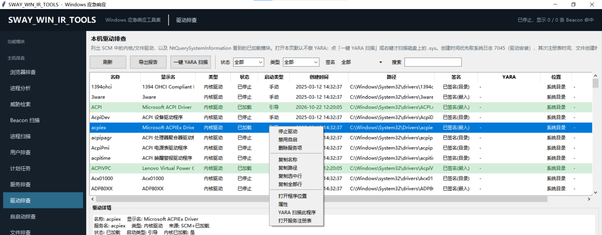	

### 自启动排查

这个自启动排查功能，把网上大部分能够持久化的地方都进行统一的排查，比如可以检查登录运行、启动文件夹、Winlogon、映像劫持、AppInit、WMI 订阅、BITS 任务和 COM 劫持等常见持久化，核对每项的程序、用户、签名和 YARA 结果。计划任务和服务单独在对应功能中排查。

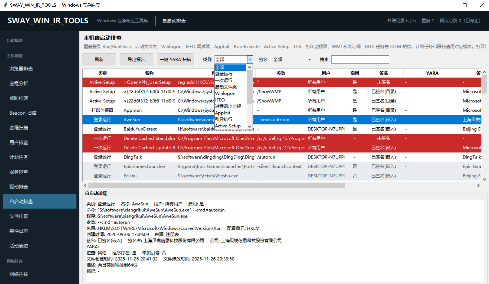		

### 文件排查

扫描下载目录、桌面、临时目录和 C 盘非系统目录中的可执行文件、脚本、压缩包与快捷方式，查看创建时间、签名、来源区域和异常标记，并可对选中文件做 YARA 扫描。用于发现新落地的样本和双扩展名、隐藏文件。

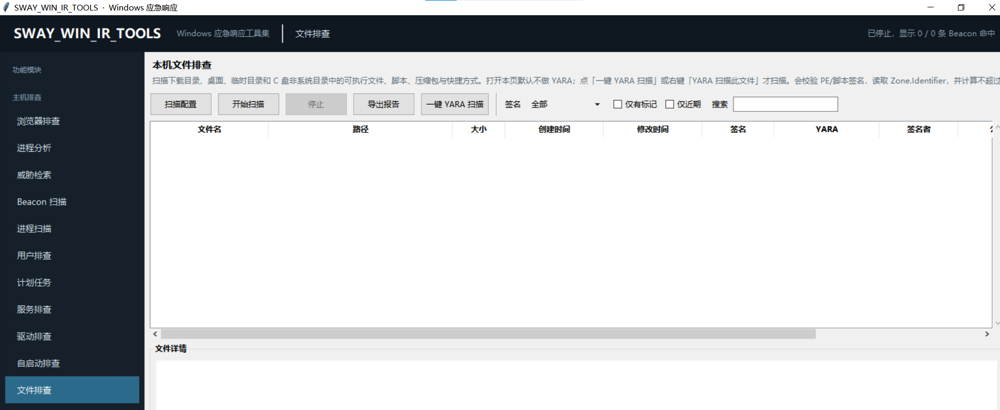	

### 事件日志

按登录认证、远程桌面、账户变更、权限组、共享访问、持久化、进程创建、PowerShell 和防御规避等类型提取相关事件。用于还原登录来源、账户改动、服务或任务安装，以及日志和防护被关闭的痕迹。

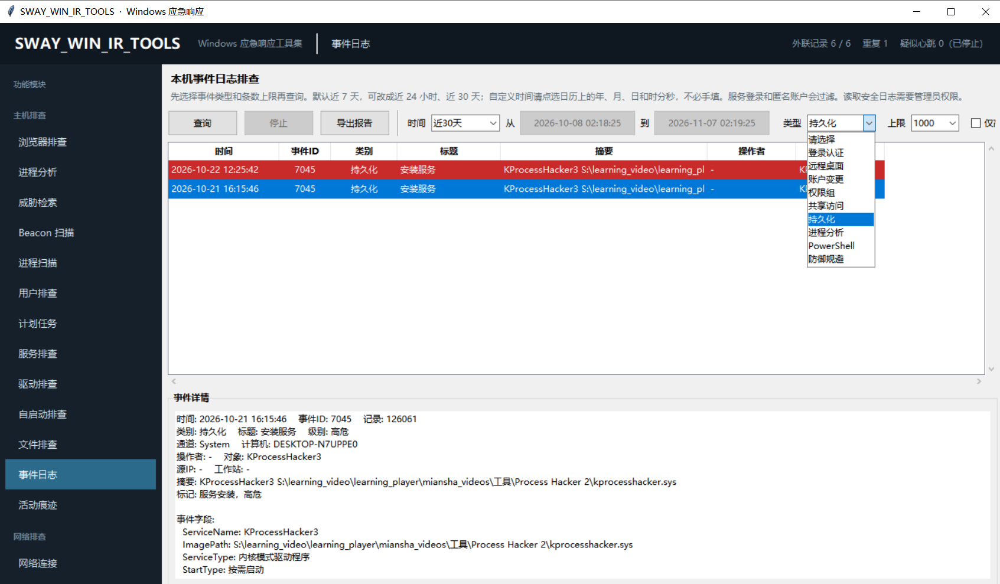		

### 活动痕迹

从系统事件、Prefetch、UserAssist、最近访问、卸载记录、Amcache 和 PowerShell 控制台历史中查看开机、登录、程序执行、文档访问和软件安装等活动。用于补充当前进程里已经看不到的历史执行记录。

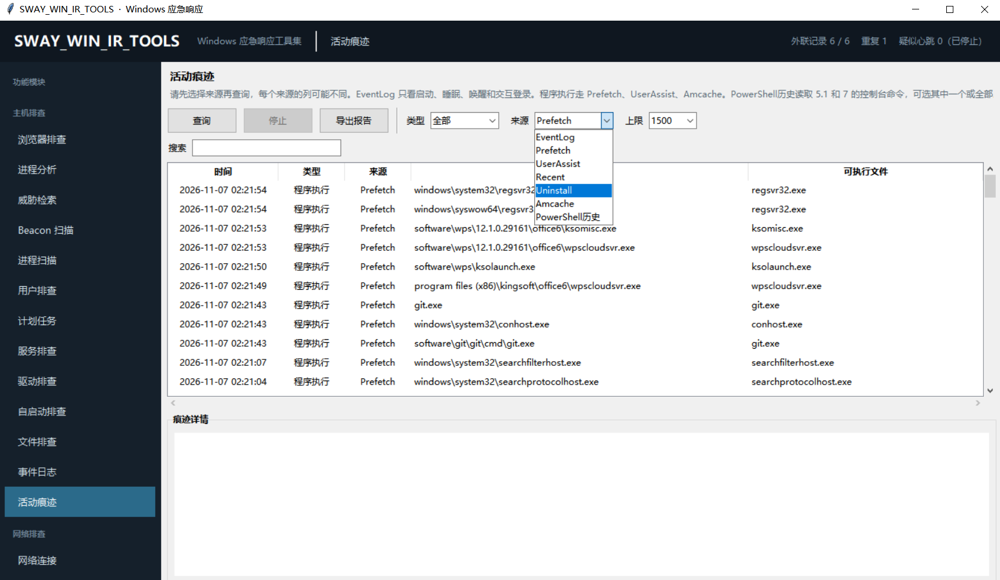		

### 网络连接

视图设置成当前连接，可以查看各个进程中TCP、UDP 的连接情况，且筛选区分外联外网、内网和监听端口，用于确认哪个恶意进程外联恶意的ip地址。

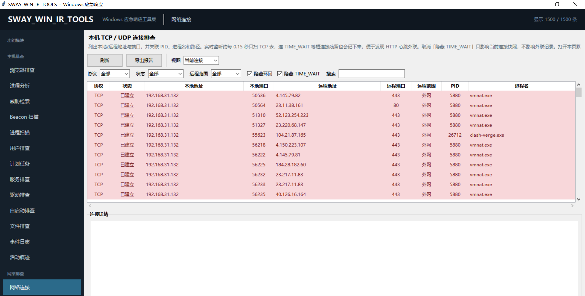	

网络连接功能，视图切换成外联记录，可以点击开始监听，从而进行实时监听哪个进程分别外联了哪些ip地址，如果在应急响应中有态势感知设备等告警告知木马外联的恶意ip，那么可以配合安全设备快速定位恶意ip，且下图中第四列的间隔秒，可以计算出上一次外联这个ip和这次外联ip的间隔时间，从而帮助应急响应人员判断这个进程是否存在心跳机制，因为木马进程大部分都存在定时心跳通信。

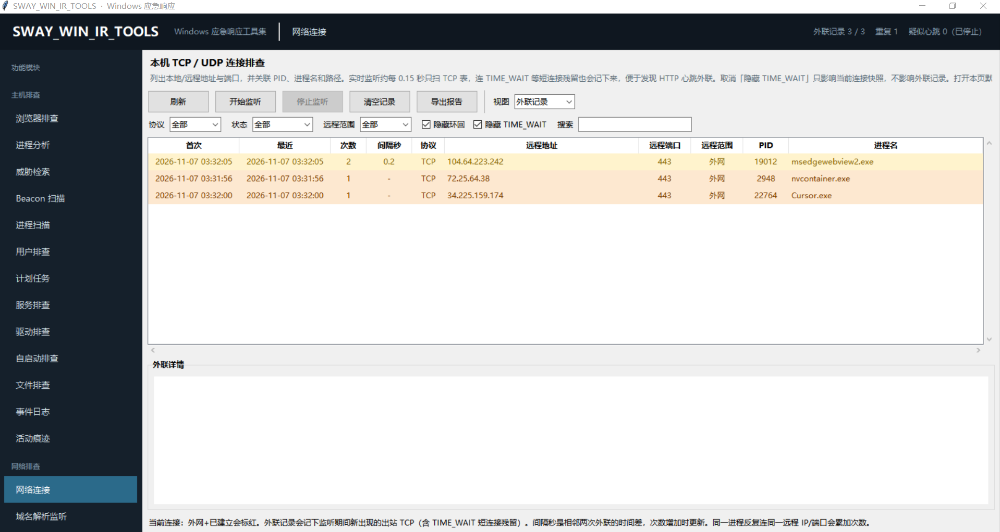		

### 域名解析监听

这个域名解析监听模块的功能，可以点击开始监听，从而监听一段时间内记录本机哪些进程对哪些域名发起解析请求，若有恶意钓鱼域名，则可以方便快速定位恶意进程。

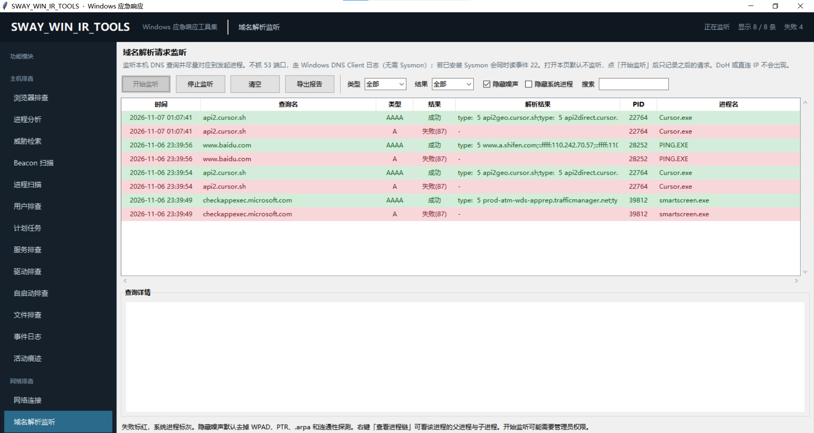	

## MCP功能

接下来这个功能是本工具的核心功能，可以帮助甚至是不懂网络安全的人员都能够使用AI自行进行应急响应排查分析处置，可以实现ai自动化分析排查受害机器，即把工具在受害机器作为MCP服务启动，让Agent使用MCP服务作为媒介，来结合上述的功能排查受害机器，此外为了保证Agent在受害机器误操作，所有的MCP工具都是只读工具，不会对受害机器进行删改查，因为目前AI+应急响应也存在上下文过多，且模型分析错误导致误报删除或者修改一些配置的情况，所以本工具的MCP功能为了解决这个问题，把所有的工具都作为只读，即只会进行数据查询操作。那么如果受害机器中了木马，受害机器上启动 MCP 后，AI 可以通过只读接口自行调取浏览器排查、进程分析、威胁检索、Beacon扫描、进程扫描、用户排查、计划任务、服务排查、驱动排查、自启动排查、事件日志和活动痕迹、网络连接和域名解析监听等功能的结果，进行连续核对证据并给出处置方法，然后安全人员根据Agent给定的处置建议进行确认无误后，即可进行处理。

在工具所在目录执行下面的命令，默认只监听本机，AI 客户端连接 http://127.0.0.1:8765/mcp：

```text
SWAY_WIN_IR_TOOLS.exe --mcp --port 8765
```

当需要让其他机器用Agent访问受害机器MCP时，需指定监听地址，然后把连接地址 http://受害机器IP:8765/mcp发给agent，那么agent就会进行自动化应急响应分析。

```text
SWAY_WIN_IR_TOOLS.exe --mcp --mcp_ip 受害机器IP --port 8765
```

`--port` 必须填写。不写 `--mcp_ip` 时只监听 `127.0.0.1`。读取安全日志和进程内存时，请以管理员身份启动。

MCP 共提供 27 个只读工具。文件排查只在图形界面中使用，不在这些工具里。

| 排查 | 工具 | 作用 |
| --- | --- | --- |
| 浏览器 | `browser_extensions_list`、`browser_extension_detail` | 查询 Chrome、Edge 插件列表和单条详情 |
| 浏览器 | `browser_downloads_list`、`browser_download_detail` | 查询下载记录和单条详情 |
| 进程分析 | `process_list`、`process_detail` | 查询进程列表，以及某个进程的哈希、命令行、模块和进程链 |
| 威胁检索 | `threat_scan` | 按 IOC 检索进程名、路径、命令行、模块、哈希和内存 |
| Beacon 扫描 | `beacon_scan` | 扫描进程堆内存中的 Cobalt Strike Beacon 配置 |
| 进程扫描 | `process_scan` | 用 YARA 规则扫描进程内存 |
| 用户排查 | `user_list`、`user_detail` | 查询本机账户列表和单个账户详情 |
| 计划任务 | `task_list`、`task_detail` | 查询计划任务并对程序做 YARA，再查看单个任务 |
| 服务排查 | `service_list`、`service_detail` | 查询服务并对程序做 YARA，再查看单个服务 |
| 驱动排查 | `driver_list`、`driver_detail` | 查询驱动并对程序做 YARA，再查看单个驱动 |
| 自启动排查 | `autorun_list`、`autorun_detail` | 查询自启动项并对程序做 YARA，再按返回的键查看详情 |
| 事件日志 | `event_list`、`event_detail` | 按类型查询事件，再按返回的键查看单条详情 |
| 活动痕迹 | `activity_list`、`activity_detail` | 按来源查询活动痕迹，再按返回的键查看单条详情 |
| 网络连接 | `connection_list`、`connection_watch` | 查询当前连接，或在限定时间内监听出站 TCP |
| 域名解析 | `dns_listen`、`dns_detail` | 在限定时间内监听域名解析，再查看单条请求详情 |

该应急工具支持两种开启方式，第一种双击打开是图形化应急响应工具，第二种打开是命令行作为mcp开启，建议都以管理员身份进行启动，否则可能会出现一些权限问题导致无法查询到全部的信息。如下图cmd以管理员身份启动，然后按照启动mcp命令行格式，即可启动mcp服务。

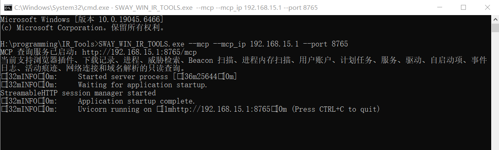	

我自己实测通过靶机模拟中白加黑的免杀马，且设置多个持久化项，然后在靶机启动mcp，另一台机器使用主流的agent调用mcp分析，下面的一些图片是我使用cursor 进行自动化应急响应分析的部分信息。经测试agent发现了所有的持久化项，并告诉我应急处置的建议，关于agent的使用不过多介绍，大家可以使用cursor、trae、codex等agent都行，只要这个agent支持使用mcp，且能够联网访问到这个mcp服务，就能够让ai进行自动化应急响应分析排查。

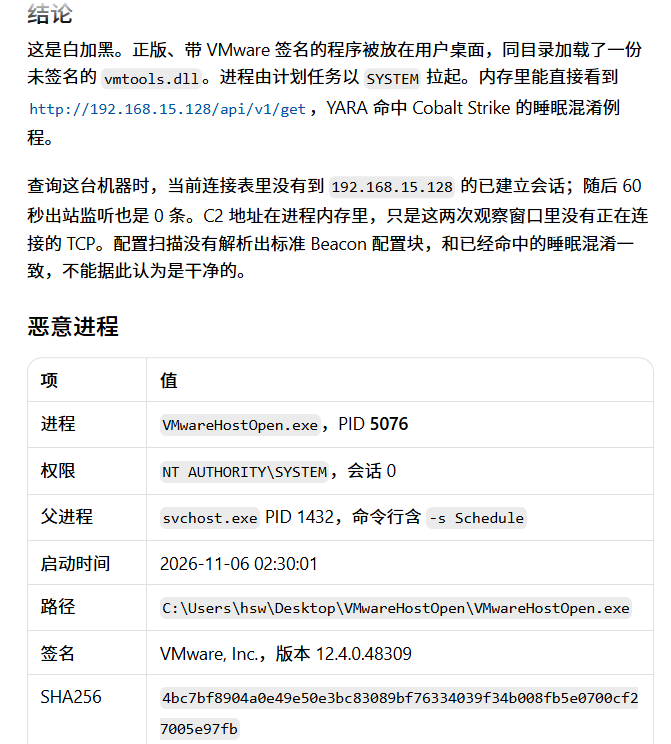	

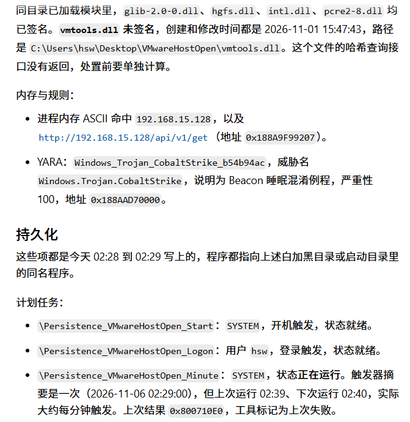	

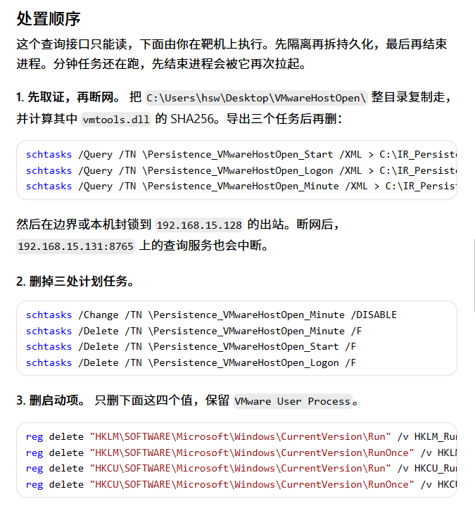	

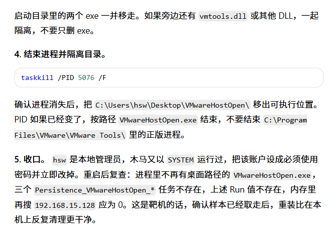	


